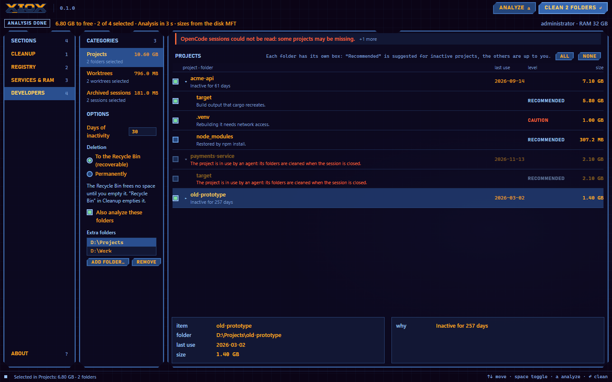
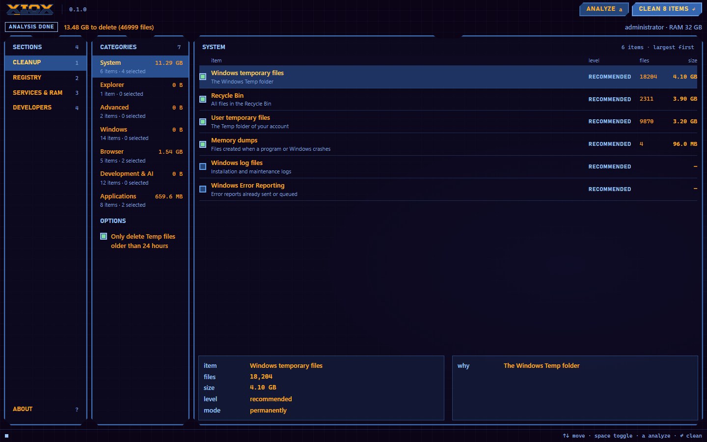
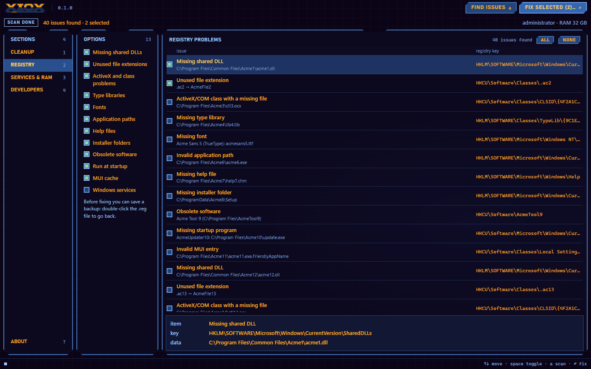
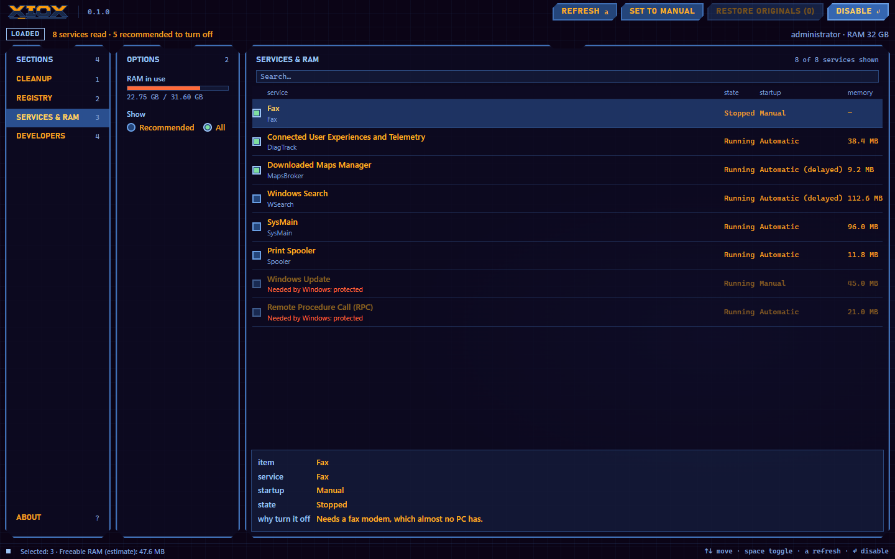
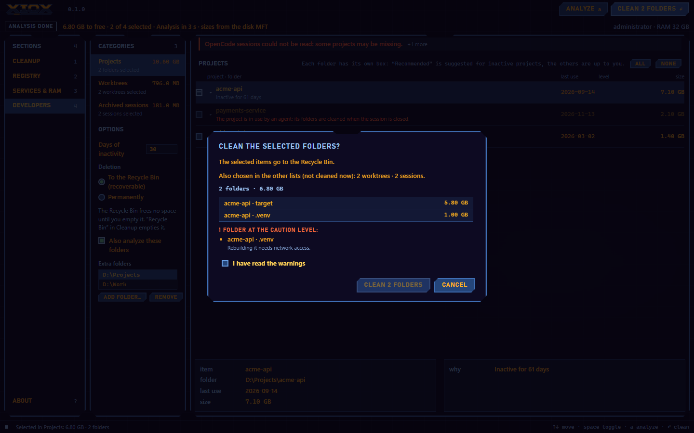

<h1 align="center">
  
</h1>

<p align="center"><strong>Find what your projects leave behind, and take it out safely.</strong><br>
A Windows cleaner for people who code, with a command line that agents can drive.</p>

<p align="center">
  <a href="#why-xiox">Why</a> ·
  <a href="#the-command-line">Command line</a> ·
  <a href="#the-desktop-app">Desktop app</a> ·
  <a href="#safety">Safety</a> ·
  <a href="#build">Build</a> ·
  <a href="#roadmap">Roadmap</a> ·
  <a href="#the-suite">Suite</a>
</p>

<p align="center">
  
  
  
  
</p>

---

## Why Xiox

Weeks of work with coding agents leave a trail. Rust `target` folders of 20 GB. Worktrees nobody remembers. Copies of a repository on another disk, a benchmark folder here, a backup there, archived agent sessions everywhere. The disk fills up and no generic cleaner knows which of it belongs to which project.

Xiox knows. Point it at **one project** and it lists everything on the PC that belongs to it: builds, git worktrees, other copies of the repository (even on other disks), folders named after it, log files, and the archived sessions of your coding agents. Then it removes only what you name.

- **It proposes, you choose.** Nothing is hidden and nothing is removed by default. Every entry has a level (`recommended`, `optional`, `caution`) and a reason; some are *blocked* and cannot be removed at all.
- **Work you did not save is never the price.** A worktree with uncommitted changes, a commit that exists nowhere else, a copy of the repository with its own commits or stash: all blocked, even with `--include`.
- **Built for scripts and agents.** Stable exit codes, one JSON object on stdout, no prompt when you pass `--yes`.

Agent session discovery is powered by **[Mukade](https://github.com/acaprino/mukade)**, embedded in Xiox through `xiox-mukade`. It reads session listings and metadata from the local stores of Claude Code, Codex, OpenCode and Pi. Xiox associates those sessions with projects and applies its cleanup safety rules.

## The command line

`xiox` is one small executable (about 3 MB). It never asks for administrator rights.

```text
> xiox analyze C:\work\sampleapp
Project  sampleapp   C:\work\sampleapp   (git, origin github.com/acme/sampleapp)
Search   fixed drives to 3 levels (deeper folders may be missed; an elevated terminal uses the MFT index)

BUILDS                                                            11 MB
  recommended   11 MB  C:\work\sampleapp\target      Rust build

WORKTREES                                                          2 MB
  blocked        1 MB  C:\work\sampleapp-wip         uncommitted changes
  recommended    1 MB  C:\work\sampleapp-feature     clean, on branch feature

COPIES                                                             2 MB
  blocked        1 MB  C:\work\sampleapp-experiment  has commits or changes the project does not have
  caution        1 MB  C:\work\sampleapp-clone       copy of the repository: same origin and first commit, no own work

NAMED                                                              1 MB
  caution        1 MB  C:\work\sampleapp-bench       matched by name only

LOGS                                                               2 MB
  recommended    2 MB  C:\work\sampleapp\debug.log   log file, ignored by git

BRANCHES (not removed)
  feature   merged
  old-idea  merged
  wip       merged

Total 18 MB · recommended 14 MB
Clean with: xiox clean "C:\work\sampleapp" --builds --worktrees --logs
```

*(a real run on a throwaway project, paths shortened)* The last line is a ready-made command for the recommended part. Everything else needs a deliberate choice, or cannot be removed at all.

```text
xiox clean C:\work\sampleapp --builds --worktrees          # summary, then a y/N question
xiox clean C:\work\sampleapp --include D:\sampleapp-bench  # a folder found by name, one by one
xiox clean C:\work\sampleapp --builds --dry-run            # every check, no removal
xiox clean C:\work\sampleapp --builds --yes --json         # for scripts and agents
```

| Flag | What it does |
|---|---|
| `--builds` `--worktrees` `--logs` `--sessions` | take the `recommended`, unblocked entries of that category |
| `--include <path>` | add one entry of any level from the listing (never a blocked one) |
| `--permanent` | delete instead of sending to the Recycle Bin (worktrees are always removed by git) |
| `--dry-run` | run every check, remove nothing |
| `--yes` | skip the question (required with `--json`) |
| `--json` | one JSON object on stdout, schema 1 |

Exit codes: `0` done, `1` error, `2` bad usage or refused, `3` partial (something was skipped or failed).

**[Full guide: docs/xiox-cli.md](docs/xiox-cli.md)**: categories, levels and blocks, JSON fields, PowerShell and agent examples, limits.

### Observe a project

`xiox observe` is a process that you (or an agent harness) start for one project. It takes a snapshot, checks again at intervals and tells its caller what **appeared since it started**: new worktrees, copies, build folders and how much they grow. It never removes anything; the report carries a ready `xiox clean` command for the new items.

```text
xiox observe C:\work\sampleapp                 # one JSON object per line on stdout; stdin: report, stop
xiox observe C:\work\sampleapp --mcp           # a read-only MCP server on stdio (tool: project_leftovers)
```

```json
{"command": "xiox", "args": ["observe", "C:\\work\\sampleapp", "--mcp"]}
```

*(the last line is the stanza to add to an MCP client)* **[Guide: docs/xiox-observe.md](docs/xiox-observe.md)**: events, report, thresholds, MCP mode, client configuration, limits.

## The desktop app

`xiox-ui.exe` is a Windows desktop app built with [Tauri 2](https://tauri.app) on the same engine and the same safety rules as the command line. It has four sections:

| Section | What it does |
|---|---|
| **Cleanup** | temporary files, caches, browser data, logs; the Winapp2-style rules catalog and the embedded developer cleaners |
| **Registry** | scan for broken entries, back them up as a `.reg` file, fix the ones you ticked |
| **Services & RAM** | turn off or set to Manual the services nobody needs, with the originals saved so you can restore them |
| **Developers** | one view over every project on the PC: builds, worktrees, archived agent sessions, with the same blocks as `xiox clean` |

The look follows the suite: a violet-black stage, steel-blue frames with cut corners, amber type, two sidebars (sections, then categories) and the detail of the selected row under the list. It is dark only and English only.

<p align="center">
  
</p>

<table>
  <tr>
    <td width="50%"></td>
    <td width="50%"></td>
  </tr>
  <tr>
    <td width="50%"></td>
    <td width="50%"></td>
  </tr>
</table>

<p align="center"><sub>The desktop app, rendered here with sample data.</sub></p>

- **Nothing is removed without a confirmation.** Every clean opens a dialog that lists what will run and its warnings; items at the `caution` level need the box "I have read the warnings" ticked first.
- **Keyboard first.** `↑` `↓` move, `space` toggles, `a` analyzes, `Enter` cleans (and asks first), `Esc` closes a dialog, `?` opens About. Every control is also reachable with `Tab`.
- **It asks for administrator rights at start**, as the old window did: the registry, the services and the system folders need them. The status bar shows `administrator` or `standard user`. The command line never asks.
- **Same guards as the CLI.** The page only sends clicks: what can be selected or removed is decided in Rust, through the same `xiox_cleaner` guard and the fresh analysis before every removal.
- **No network from the window**, apart from the Winapp2 rules update, which runs in the engine as before.

**[User guide: docs/xiox-desktop.md](docs/xiox-desktop.md)**: the four sections, the keys, what each warning means, the options, limits.

## Safety

The engine is written so that a mistake costs a skipped entry, not your work.

- **Fresh analysis before every removal.** `clean` re-runs the analysis and removes only entries that are still there, in the same category, still unblocked. An item that changed since you looked is skipped, and the exit code says so.
- **No link is ever followed**: symbolic links and junctions are refused at the item, its parent and the walk.
- **Worktrees go through `git worktree remove`, never forced.** Dirty, unpushed or in-use worktrees are blocked.
- **Copies with unsaved work, or whose state cannot be read, are blocked.** So is any folder that holds one.
- **The Recycle Bin is the default.** `--permanent` is explicit, and the summary says which one applies before you answer.
- **Protected locations, drive roots and top-level folders are refused.** Category flags are also refused on a folder that is not one project (a drive root, your profile, a folder with several repositories).
- **English-only, machine-readable output**, so an agent can read every reason.

## Build

You need [Rust](https://rustup.rs/) (stable), [Node.js](https://nodejs.org/) (24 or newer), Git and the Microsoft Edge WebView2 runtime (part of Windows 11 and of current Windows 10) on Windows.

```text
git clone https://github.com/acaprino/xiox.git
cd xiox
npm ci
npm run desktop:release
cargo build --release --locked -p xiox-cli
```

Binaries land in `target\release\`: `xiox-ui.exe` (desktop app, built by Tauri without an installer) and `xiox.exe` (command line). On a small machine build with `CARGO_BUILD_JOBS=1`: the Tauri build is long and memory-hungry.

Tests:

```text
cargo test --workspace --exclude mukade   # the engine, the state machines and the Tauri commands
npm test                                  # the TypeScript of the page
npm run smoke                             # the page in a browser on sample data: screenshots, focus, fit, language
```

The workspace is the Rust engine as crates: `xiox-git` (git queries), `xiox-scanner` and `xiox-engine` (what exists and what it is), `xiox-cleaner` (the only code that removes), `xiox-project` (per-project analysis and cleaning), `xiox-sessions` and `xiox-mukade` (agent sessions), `xiox-rules` (the Winapp2-style catalog), `xiox-core` (the state of the four sections, shared by every front end), `xiox-cli`, and `apps/desktop` (the Tauri app: `src-tauri` is the Rust side, `src` the TypeScript page).

## Roadmap

- [x] `xiox analyze` and `xiox clean` for one project, with a [guide](docs/xiox-cli.md)
- [x] `xiox observe <project>`: an observer that a harness or an agent starts for its own project; it warns (never cleans) when worktrees, copies and backups pile up, as JSON lines or as a read-only MCP server, with a [guide](docs/xiox-observe.md). [Design](docs/superpowers/specs/2026-11-13-project-observer-mcp-design.md)
- [x] A **Xiox** desktop app: Tauri 2, the same engine, the interface above, with a [guide](docs/xiox-desktop.md)
- [ ] A tab in [Mukade](https://github.com/acaprino/mukade) that starts observers and shows their warnings

## The suite

Xiox sits next to the other tools built on the same ideas: local first, readable output, nothing hidden.

| | |
|---|---|
| **[Mukade](https://github.com/acaprino/mukade)** | move a coding-agent session between Claude Code, Codex, OpenCode and Pi |
| **[Daodan](https://github.com/acaprino/daodan)** | a verifiable map of the code and an evidence-bound review for coding agents |
| **Shinatama** | a local terminal runtime that hosts and orchestrates coding-agent harnesses |

## Status and license

Early, in daily use by its author. Contributions are not open yet. License: not chosen yet, all rights reserved.

---

<p align="center"><sub>Design notes live in <a href="docs/superpowers">docs/superpowers</a>. The logo and the interface take their cut corners and amber type from the options menu of the video game <em>Oni</em>; the logo is described <a href="docs/assets/branding/xiox-logo-generation.md">here</a>.</sub></p>
